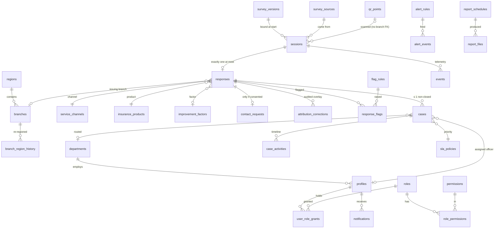
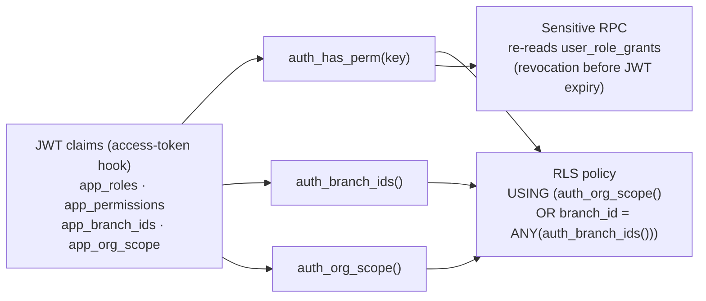

# Data model

The authoritative column lists are in SPEC §2.3. This file holds the ERD, the schema boundaries, the RLS model and the Phase 0 additions. Migrations (MS-01 onward) must match it, and if a migration changes the model, this file changes in the same PR.

## 1. Schemas and exposure

| Schema | Holds | Data API exposed? | Access path |
|---|---|---|---|
| `public` | Directory, catalogues, survey versions, QR points, flags, cases, targets, alerts, notifications, reports, settings | Yes, RLS on every table | Portal JWT |
| `survey` | sessions, responses, device cooldowns, attribution corrections, events | **No** | `survey.*` SECURITY DEFINER functions (Worker); portal reads through `analytics.v_response_records` (RLS-scoped view) |
| `analytics` | daily roll-ups, views (`v_responses_effective`, `v_response_records`, `v_branch_ranking`) | Views only, `security_invoker` | Portal JWT; the analytics RPCs |
| `pii` | contact_requests | **No** | `pii.reveal_contact`, `pii.erase_contact`, `privacy_find_contact` only (audited) |
| `audit` | log (hash-chained, partitioned) | View `audit.v_log` only | Auditor / System Admin |
| `ops` | outbox queue, job runs, quota snapshots, sign-in attempts | **No** | Jobs, plus the `ops.v_quota_status` view |

## 2. ERD (core entities)

## 3. Integrity rules enforced in the database

| Rule | Mechanism |
|---|---|
| One response per session | `UNIQUE (survey.responses.session_id)` + `SELECT … FOR UPDATE` on the session in `survey.submit` |
| Idempotent submit | `sessions.submit_idempotency_key` stored on first success; a replay returns the stored reference |
| Responses immutable | `BEFORE UPDATE OR DELETE` trigger raises unless `current_setting('app.retention_redact') = 'on'` (set only inside `retention_redact()`); `REVOKE UPDATE, DELETE` from every role |
| Branch status consistency | `CHECK ((branch_status = 'selected') = (issuing_branch_id IS NOT NULL))`; `not_applicable` validated against the bound version in `survey.submit` |
| Scores in range | `CHECK csat 1–5, ces 1–5, nps 0–10`; `nps_class` is a generated column |
| Free-text limits | `CHECK length(comment) <= 1000`, other-texts 80/200 |
| One published survey | Partial unique index `ON survey_versions ((true)) WHERE status = 'published'`; a trigger blocks edits to published rows |
| Catalogue codes immutable | Trigger rejects `UPDATE OF code`; no `DELETE` grants (deactivate only) |
| Exactly one `is_other` / `is_none` | Partial unique indexes per catalogue |
| One non-closed case per response | Partial unique index `ON cases (response_id) WHERE status <> 'closed'` |
| Case transitions | `case_*` functions + `BEFORE UPDATE` trigger with the allowed-transition table |
| Optimistic locking | `version int`, incremented by trigger; functions take `p_expected_version` |
| Audit chain | `audit.append(...)` takes `pg_advisory_xact_lock(hashtext('audit.log'))`, reads the last hash and writes `hash = sha256(prev_hash ‖ canonical_json(row))` (A-141) |
| Last System Administrator | Trigger on `user_role_grants` / `profiles` refuses to remove the last active System Admin grant |

## 4. RLS model

* Helpers are `STABLE`, read `auth.jwt()`, and are wrapped as `(select auth_has_perm(...))` in policies so Postgres evaluates them once per statement, not per row.
* Branch Managers' cross-branch visibility is aggregate-only, through `analytics.v_branch_ranking` (n, CSAT %, NPS, CES, negative rate). That view never exposes record ids or comments [D-24, D-34].
* Resolution Officers' "A" (assigned) scope: `cases.assigned_officer_id = auth.uid()`; responses are visible to them only through a join to their assigned cases.
* CI gates: `supabase db lint`, and a pgTAP test that fails if any `public` table has RLS disabled or no policy, or if any `SECURITY DEFINER` function lacks `SET search_path = ''`.

## 5. Phase 0 additions to SPEC §2.3

| Change | Why |
|---|---|
| `qr_points.mode text NOT NULL DEFAULT 'poster' CHECK (mode IN ('poster','kiosk'))` | A-150 / Q-36 |
| `sessions.submit_idempotency_key uuid`, `sessions.draft_write_count int` | Idempotent replay; the ≤ 60 draft-writes limit |
| `responses.verification text CHECK (verification IN ('verified','unverified_turnstile_outage','unverified_no_js'))` | A-135, A-144: the reason a response is unverified stays visible |
| `profiles.last_password_change_at timestamptz` | Password-change audit; forced-change flow |
| `ops.auth_sign_in_attempts (id, at, email_hmac, ip_hmac, outcome)` (30-day retention) | Lockout and the sign-in spike alert without storing raw emails/IPs in ops tables |
| `ops.job_runs (job, started_at, finished_at, status, detail)` | Backup, roll-up and retention status on the health page |

## 6. Retention jobs (pg_cron, Africa/Accra 03:00)

As SPEC §2.3 "Data retention". Each run writes an `audit.log` entry (`retention.run`) with counts per category.
