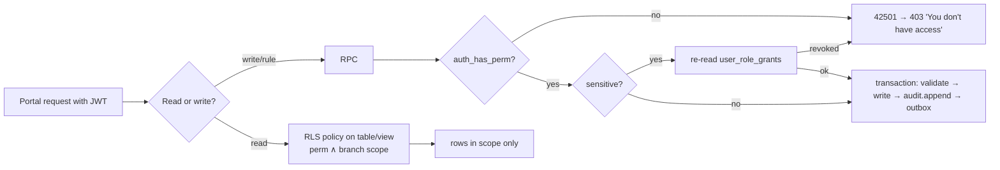
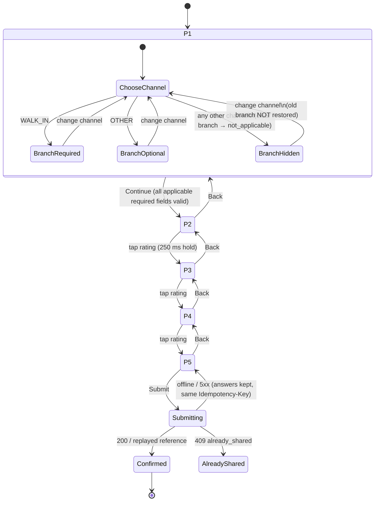
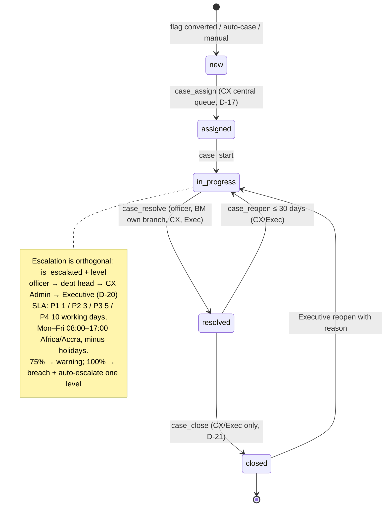
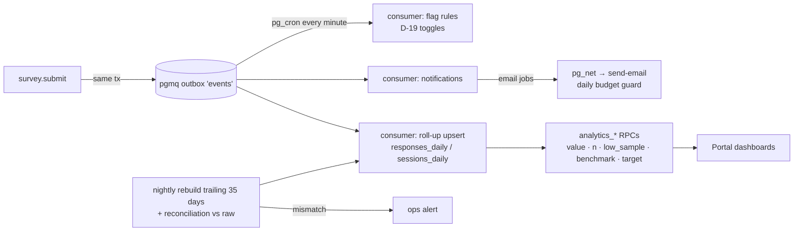

# Core flows and state machines

## 1. Staff authentication (F16)

```mermaid
sequenceDiagram
  autonumber
  actor A as System Admin
  actor U as New staff user
  participant P as Portal SPA
  participant IF as Edge fn invite-user
  participant SI as Edge fn auth-sign-in
  participant AU as Supabase Auth
  participant DB as Postgres
  A->>P: Invite (email, role, branch scope)
  P->>IF: POST (admin JWT)
  IF->>DB: check users.manage, create profile (invited, must_change_password)
  IF->>AU: admin.inviteUserByEmail (24 h, single use)
  AU-->>U: Invite email (Resend SMTP)
  U->>P: Open link → "Set a new password"
  P->>AU: updateUser(password ≥ 12, not common)
  U->>P: Sign in (email, password)
  P->>SI: POST credentials (+ Turnstile token)
  SI->>DB: locked_until in future? → generic "can't sign in" + retry-after
  SI->>AU: signInWithPassword (server-side)
  alt wrong password
    SI->>DB: failed_login_count++ (5 → lock 15 min, email notice)
    SI-->>P: enumeration-safe error
  else success
    AU->>DB: access-token hook: claims; refuse if session older than 12 h
    SI->>DB: reset counter; new device? → security email
    SI-->>P: session → supabase.auth.setSession()
    P->>P: must_change_password → forced "Set a new password" screen
  end
```

## 2. Authorisation (every portal request)



## 3. Survey session (F1, F2, F5–F7)

```mermaid
sequenceDiagram
  autonumber
  actor C as Customer
  participant W as survey Worker
  participant DB as Postgres (survey.*)
  participant T as Turnstile
  C->>W: GET /?src=sms  or  /q/K7P2
  W->>DB: start_session(src, qr, device_hmac, session_hmac?)
  alt device inside cooldown
    DB-->>W: cooldown(reference?)
    W-->>C: S-C7 "You've already shared your feedback"
  else DB unreachable
    W-->>C: S-C8 "We can't take feedback right now" (no form)
  else ok
    DB-->>W: session (new or resumed), bound version, draft
    W-->>C: Page 1 HTML + inlined definition + catalogue (edge-cached by checksum)<br/>Set-Cookie __Host-svs (24 h), __Host-svd (1 y)
  end
  C->>C: pages 1–5 run client-side, no network on page change
  C-)W: PATCH /answers {seq, answers} (debounced 300 ms, ≤ 1 in flight)
  W->>DB: save_draft (ignore stale seq; ≤ 60 writes)
  C->>T: Turnstile (on page 5 only)
  C->>W: POST /submit {answers, token} + Idempotency-Key
  W->>T: siteverify (retry once; outage → unverified)
  W->>DB: submit(): lock session, re-validate, cooldown, insert response (+pii), outbox
  DB-->>W: {reference}
  W-->>C: S-C6 confirmation (history replaced, Back can't return to the form)
  C-)W: sendBeacon /events (batched telemetry)
```

## 4. Survey page state machine (Page 1 rule, F3/F4)



## 5. Case lifecycle (F9, F10; R2)



## 6. Analytics pipeline



Roll-ups are additive histograms (csat_hist[5], ces_hist[5], nps_hist[11]), so every metric for any filter combination is an exact sum over the grain. There are no averages of averages.
