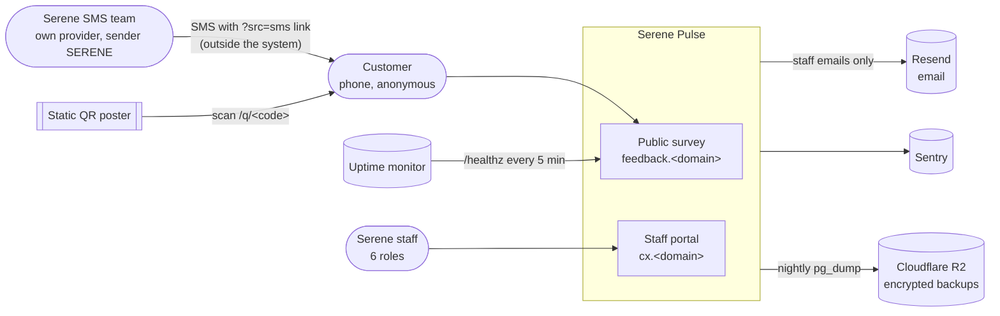
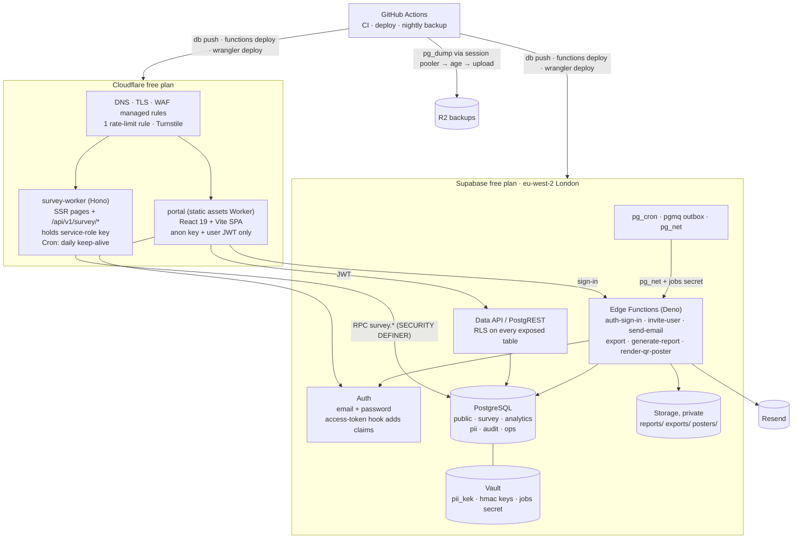
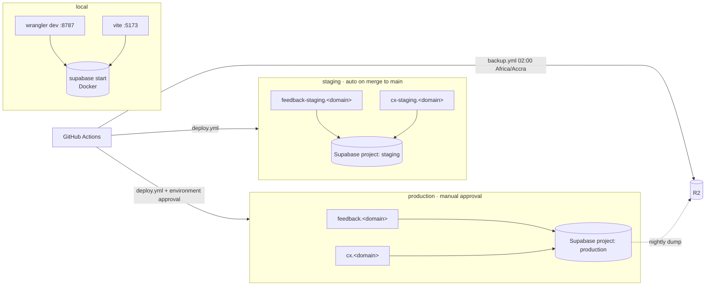

# System architecture

## 1. System context

## 2. Containers

### Boundaries (what may talk to what)

| From → To | Credential | Allowed surface |
|---|---|---|
| Browser (survey) → survey Worker | `__Host-svs` session cookie + same-origin `Origin` check | 4 survey endpoints + SSR pages |
| Survey Worker → Postgres | service-role key (Worker secret) | **Only** `survey.start_session`, `survey.save_draft`, `survey.submit`, `survey.record_events`, `ops.healthz`. Never table access |
| Browser (portal) → Supabase | anon key + user JWT | Data API views/tables under RLS; RPCs that re-check `auth_has_perm()` |
| Browser (portal) → `auth-sign-in` | none (credentials in body) + Turnstile | Sign-in, with lockout |
| pg_cron → Edge Functions | `JOBS_SHARED_SECRET` header via pg_net | `send-email`, `generate-report` |
| Edge Functions → Postgres | caller's JWT (user work) or a `jobs` role (scheduled work) | Re-checks permission before producing any file |
| CI → Supabase / Cloudflare | access token, DB URL, API token (GitHub environment secrets) | Deploys, migrations, backups |

## 3. Deployment per environment

Production data is never copied to staging. Staging gets synthetic data only, always watermarked "Demo data".

## 4. Repository layout

SPEC §2.5 is adopted as-is. Workspace manager: pnpm (A-137).
